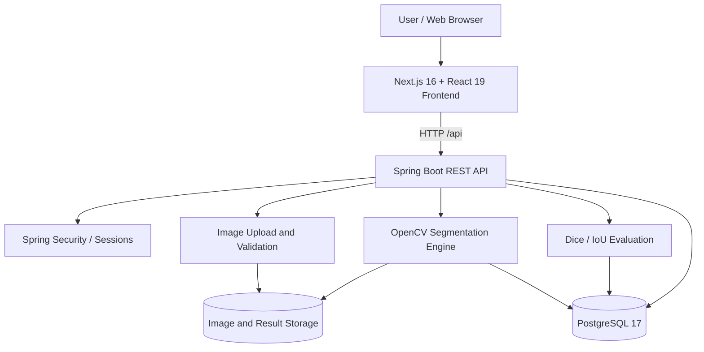
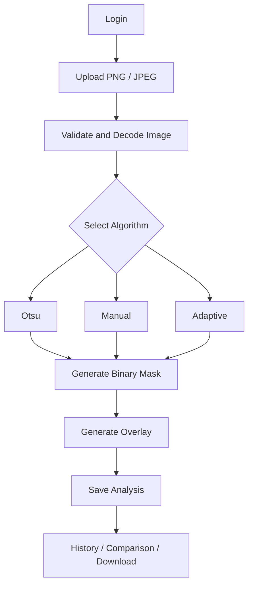

# MedVision — System Architecture

**Official project:** Image Segmentation for Medical Image Analysis

## Architecture Diagram

## Component Responsibilities

| Component | Responsibility |
|---|---|
| Next.js frontend | User interface, upload forms, visualization, history |
| Spring Boot API | Business logic, authentication, request validation |
| Spring Security | Sessions, authorization, CSRF protection |
| OpenCV | Otsu, Manual and Adaptive segmentation |
| PostgreSQL | Users, images, analyses and metadata |
| File storage | Uploaded images, generated masks and overlays |
| Evaluation module | Dice and IoU calculation |

## Segmentation Workflow

> MedVision is intended for educational and experimental use, not clinical diagnosis.