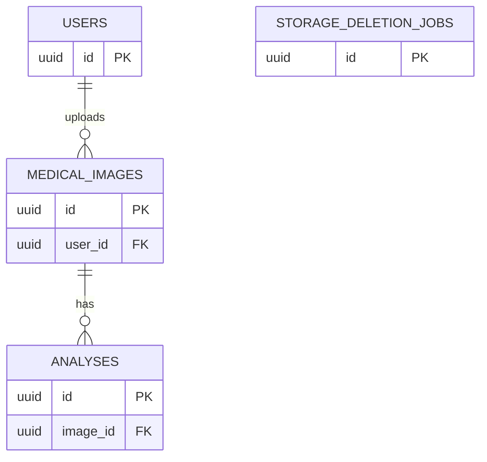

# MedVision — Database ER Diagram

**Official project:** Image Segmentation for Medical Image Analysis

## Entity Relationship Diagram

## Entity Descriptions

| Entity | Description |
|---|---|
| `users` | Registered users and authentication-related data |
| `medical_images` | Uploaded medical image metadata and ownership |
| `analyses` | Segmentation method, parameters, status, and results |
| `storage_deletion_jobs` | Storage cleanup jobs |

## Relationships

- One user can upload multiple medical images.
- One medical image can have multiple segmentation analyses.
- Each analysis belongs to a medical image.
- Storage deletion jobs support cleanup operations.

## Database Management

PostgreSQL 17 is used for persistent data storage.

Flyway is used to manage versioned database schema migrations.

> This is a high-level ER diagram. Column details and additional constraints should be verified against the final Flyway migrations.