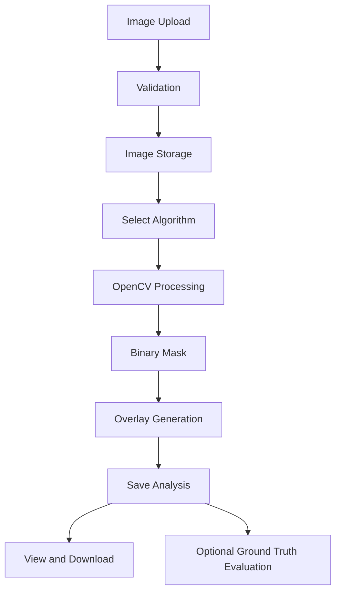

# MedVision Segmentation Pipeline

**Project:** Image Segmentation for Medical Image Analysis

## 1. Purpose

MedVision is an academic application for experimenting with threshold-based medical image segmentation.

## 2. Processing Workflow

1. The user authenticates.
2. The user uploads a PNG or JPEG image.
3. The backend validates the image format and dimensions.
4. The image is stored and its metadata is saved.
5. The user selects a segmentation algorithm.
6. The user configures algorithm parameters.
7. The backend processes the image using OpenCV.
8. A binary segmentation mask is generated.
9. An overlay visualization is generated.
10. Analysis metadata and processing results are saved.
11. The user can view and download the results.
12. If ground truth is provided, Dice and IoU are calculated.

## 3. Pipeline Diagram

## 4. Supported Algorithms

- OTSU: automatic global threshold selection.
- MANUAL: user-defined global threshold.
- ADAPTIVE: locally calculated thresholds.

## 5. Outputs

- Binary segmentation mask.
- Overlay image.
- Foreground pixel count.
- Foreground pixel ratio.
- Processing time.
- Optional Dice score.
- Optional IoU score.

## 6. Limitations

Threshold-based segmentation is sensitive to image quality, contrast, noise, and lighting variations.
The generated masks are experimental and must not be treated as clinical diagnoses.
